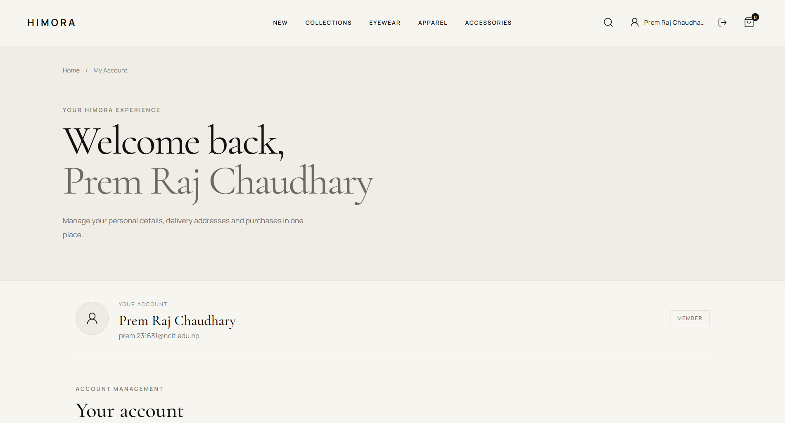
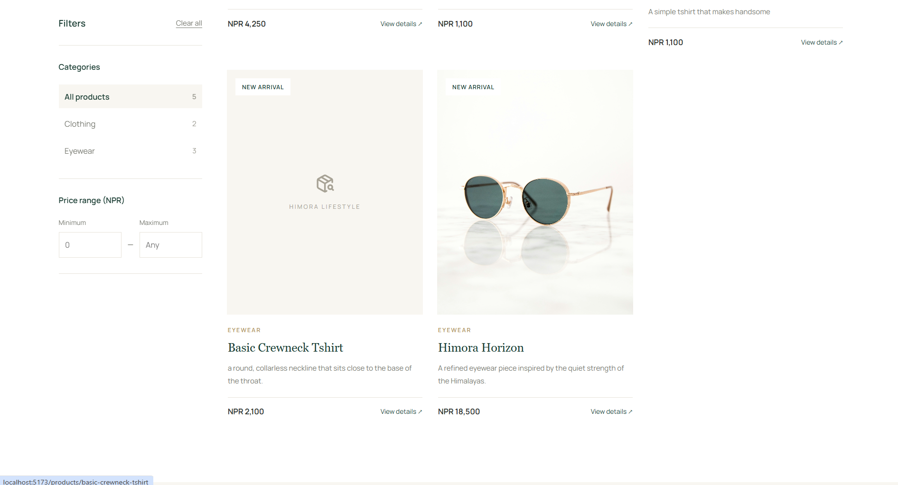
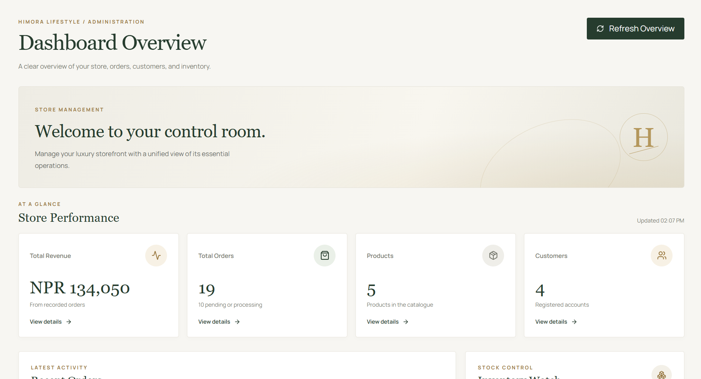
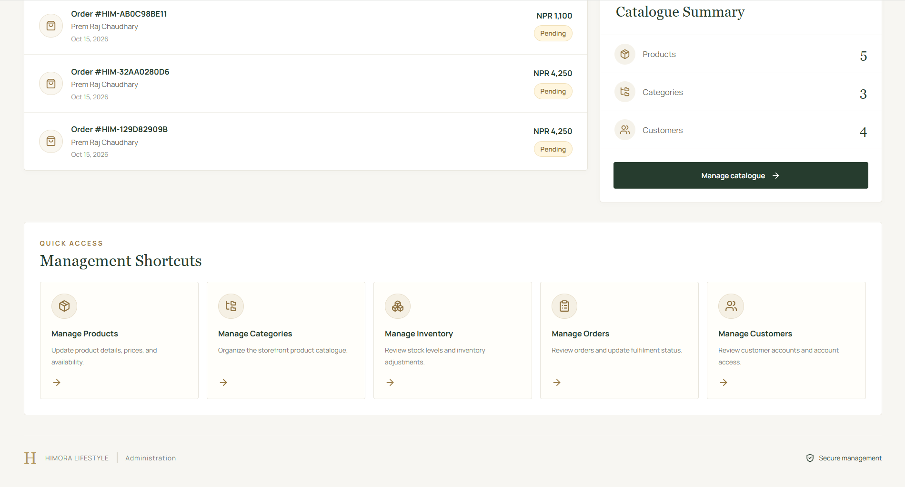
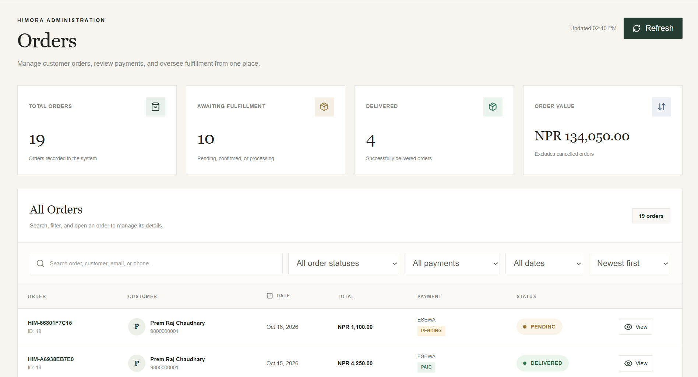
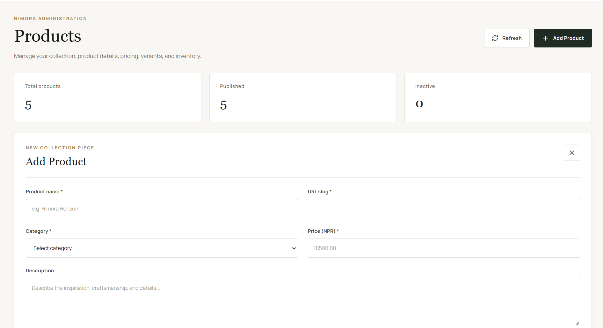
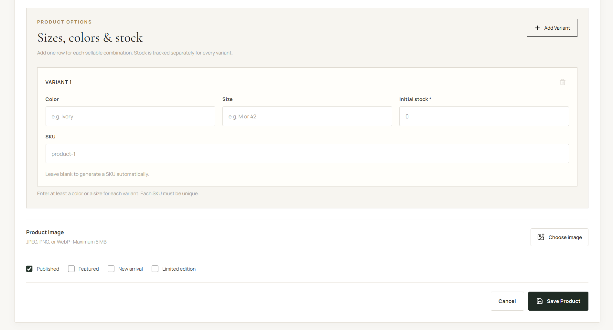
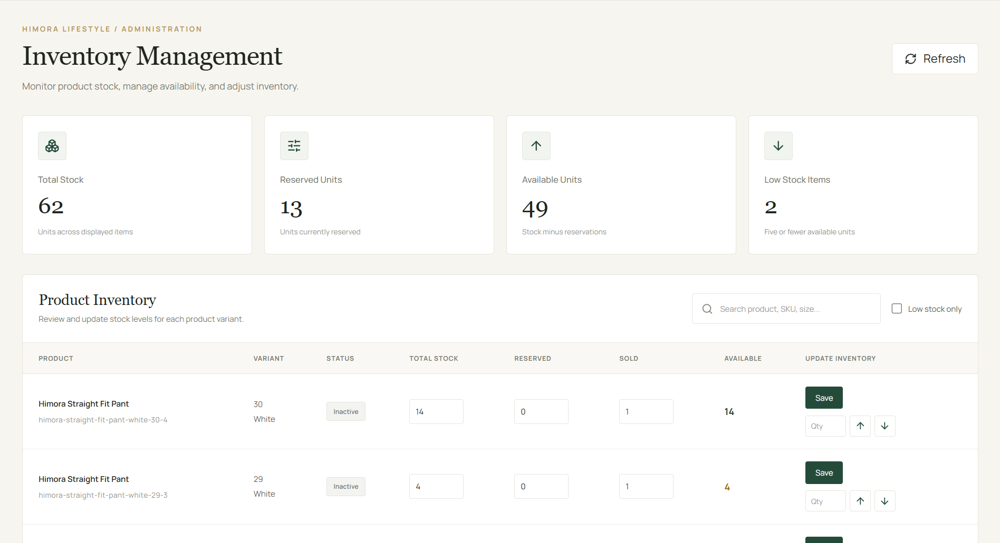
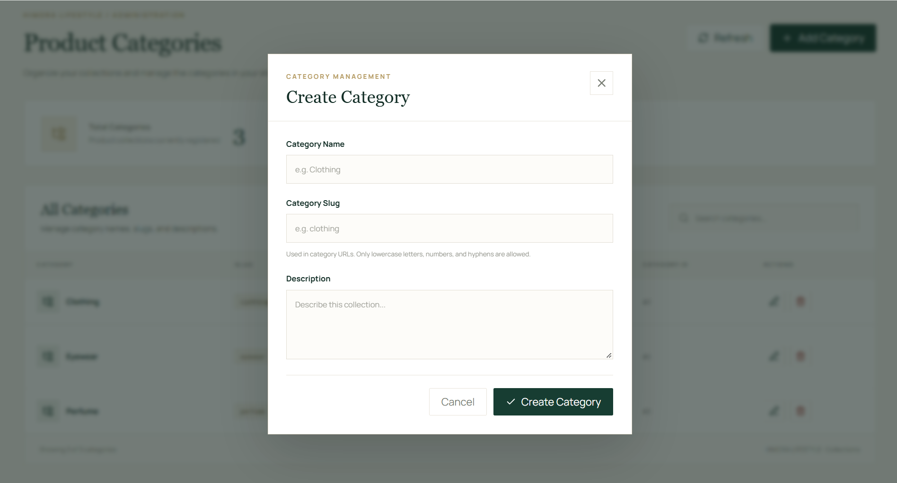

# HIMORA LIFESTYLE

A premium lifestyle e-commerce platform inspired by the Himalayas, built with React, FastAPI, and PostgreSQL. The platform provides a refined shopping experience for eyewear, apparel, and accessories, with customer accounts, shopping carts, order management, and online payments.

## Overview

HIMORA LIFESTYLE is a full-stack e-commerce application designed around a consistent premium visual identity. It combines a responsive React storefront with a FastAPI REST API and a PostgreSQL database.

The project is containerized using Docker Compose to simplify local development, testing, and deployment preparation.

## Features

### Customer Experience
- Responsive storefront with a premium editorial design.
- Product browsing and category-based navigation.
- Product details, images, pricing, and availability.
- Customer registration, login, and account management.
- Password reset through email.
- Shopping cart and quantity management.
- Saved delivery addresses.
- Checkout and order placement.
- Order history and order details.
- eSewa payment integration.
- Cash on Delivery support.

### Administration
- Administrative order management.
- Order status updates and status history.
- Order cancellation where permitted.
- Inventory and stock updates associated with order processing.

### Technical Features
- RESTful API built with FastAPI.
- PostgreSQL relational database.
- JWT-based authentication.
- Database schema migrations using Alembic.
- Dockerized frontend, backend, and database.
- Nginx for frontend delivery and API reverse proxying.
- Environment-based application configuration.

## Technology Stack

| Layer | Technologies |
|---|---|
| Frontend | React, Vite, JavaScript |
| UI and icons | CSS, Lucide React |
| Backend | Python, FastAPI |
| Database | PostgreSQL |
| ORM and migrations | SQLAlchemy, Alembic |
| Authentication | JWT |
| Payments | eSewa integration, Cash on Delivery |
| Web server | Nginx |
| Containerization | Docker, Docker Compose |
| API documentation | FastAPI Swagger UI |

## Project Structure

```text
HIMORA LIFESTYLE/
├── backend/
│   ├── alembic/
│   ├── app/
│   │   ├── api/
│   │   ├── core/
│   │   ├── models/
│   │   ├── routers/
│   │   ├── schemas/
│   │   └── services/
│   ├── uploads/
│   ├── .env
│   ├── alembic.ini
│   ├── Dockerfile
│   └── requirements.txt
├── frontend/
│   ├── public/
│   ├── src/
│   │   ├── assets/
│   │   ├── components/
│   │   ├── pages/
│   │   └── services/
│   ├── .env
│   ├── Dockerfile
│   ├── nginx.conf
│   └── package.json
├── docker-compose.yml
└── README.md
```

*Note: The structure above is a representative overview. Some directories may differ in the actual repository.*

## Prerequisites

Install the following tools before running the project:

- [Git](https://git-scm.com/)
- [Node.js](https://nodejs.org/) and npm
- [Python](https://www.python.org/) 3.12 or a compatible version
- [Docker Desktop](https://www.docker.com/products/docker-desktop/)

Docker Desktop is recommended because the project includes a Docker Compose configuration for the frontend, backend, and PostgreSQL database.

## Running with Docker Compose

### 1. Clone the repository

```bash
git clone <YOUR_GITHUB_REPOSITORY_URL>
cd "HIMORA LIFESTYLE"
```

Replace the placeholder with your actual repository URL.

### 2. Configure environment variables

Create the required backend environment file at `backend/.env`.

Configure the variables required by the application's settings, including:

- Application environment and debug settings.
- Database connection configuration.
- JWT secret and token settings.
- SMTP credentials for password-reset emails.
- Frontend URL.
- eSewa payment credentials and callback URLs.

Use strong, private secrets and the appropriate payment gateway credentials for your environment.

For the frontend, configure `frontend/.env` as needed. The current Docker setup uses Nginx to serve the frontend and proxy API requests to the backend.

**Never commit `.env` files, database credentials, JWT secrets, SMTP passwords, or payment secrets to Git.**

### 3. Start the application

From the project root, run:

```bash
docker compose up -d --build
```

Check the container status:

```bash
docker compose ps
```

View backend logs:

```bash
docker compose logs -f backend
```

View all service logs:

```bash
docker compose logs -f
```

### 4. Access the application

| Service | Local URL |
|---|---|
| Storefront | http://localhost:8080 |
| FastAPI API | http://localhost:8000 |
| Swagger API documentation | http://localhost:8000/docs |
| ReDoc API documentation | http://localhost:8000/redoc |
| Backend health endpoint | http://localhost:8000/health |

The PostgreSQL database is configured to use host port `5434` in the current local Docker setup.

## Running the Frontend Separately

To run the React development server locally:

```bash
cd frontend
npm install
npm run dev
```

Vite normally serves the frontend at:

```text
http://localhost:5173
```

Ensure the API base URL and backend CORS configuration match the selected development environment.

## Running the Backend Separately

Create and activate a Python virtual environment from the backend directory.

On Windows PowerShell:

```powershell
cd backend
python -m venv .venv
.\.venv\Scripts\Activate.ps1
pip install -r requirements.txt
```

Configure `backend/.env` before starting the API.

Start the FastAPI development server:

```powershell
uvicorn app.main:app --reload --host 127.0.0.1 --port 8000
```

The API documentation will be available at `http://localhost:8000/docs`.

Run database migrations only when required by the current schema:

```powershell
alembic upgrade head
```

Back up the database before performing schema changes on an environment containing important data.

## Environment Configuration

Environment variables are used to separate application configuration from source code.

| Configuration | Purpose |
|---|---|
| `APP_ENV` | Identifies the application environment |
| `DEBUG` | Controls debug mode |
| `DATABASE_URL` | PostgreSQL connection URL |
| `JWT_SECRET_KEY` | Secret used for token signing |
| `FRONTEND_URL` | Frontend base URL used by backend workflows |
| `SMTP_HOST` | Email service hostname |
| `SMTP_PORT` | Email service port |
| `SMTP_USERNAME` | Email account username |
| `SMTP_PASSWORD` | Email account credential |
| `ESEWA_PRODUCT_CODE` | eSewa merchant or product code |
| `ESEWA_SECRET_KEY` | eSewa integration secret |
| `ESEWA_PAYMENT_URL` | Payment submission endpoint |
| `ESEWA_STATUS_URL` | Payment verification endpoint |
| `ESEWA_SUCCESS_URL` | Payment success callback URL |
| `ESEWA_FAILURE_URL` | Payment failure callback URL |

The exact required variables depend on the application's settings and `.env` configuration. Use the variable names expected by the existing backend configuration.

For Docker Compose, the database hostname is the Compose service name `db`, and the internal PostgreSQL port is `5432`. When connecting from the host machine, use `localhost:5434` in the current configuration.

## Payment Integration

The application includes an eSewa payment integration and Cash on Delivery support.

Before enabling real payments:

1. Configure the correct merchant credentials.
2. Use the appropriate test or production gateway endpoints.
3. Set success and failure callback URLs to the correct publicly accessible HTTPS addresses.
4. Verify transactions on the backend rather than trusting the frontend redirect alone.
5. Test failed, cancelled, duplicate, and successful payment flows.
6. Confirm that stock and order states remain consistent after payment verification.

Never publish payment secrets or assume that a successful browser redirect alone proves that a payment was completed.

## Security Considerations

- Keep secret configuration out of version control.
- Use strong JWT signing secrets.
- Disable debug mode in production.
- Restrict administrative endpoints to authorized administrators.
- Validate user input on the backend.
- Enforce authentication for protected shopping and checkout operations.
- Use HTTPS for public traffic.
- Configure CORS for trusted origins.
- Protect uploaded files and validate upload types and sizes.
- Keep dependencies updated.
- Back up PostgreSQL regularly.
- Test database restoration procedures.
- Never expose PostgreSQL directly to the public internet unless a secure, deliberate configuration requires it.

## Current Docker Deployment

The project currently supports local containerized execution through Docker Compose.

The configured local endpoints are:

- Frontend: `http://localhost:8080`
- Backend: `http://localhost:8000`
- PostgreSQL host port: `5434`

The backend health endpoint and Nginx configuration have been tested locally.

**Public production deployment is not yet configured.** A public deployment will require a hosting provider, domain DNS configuration, HTTPS, production payment callback URLs, persistent file storage, secure database hosting, and a backup strategy.

## Future Improvements

Potential improvements include:

- Public HTTPS deployment under a custom domain.
- Automated tests and CI/CD pipelines.
- Enhanced product and inventory administration.
- Product image storage using persistent or object storage.
- Automated database backups and recovery.
- Monitoring, logging, and error reporting.
- Performance and accessibility improvements.
- Production payment gateway verification.

## License

Choose and add an appropriate license before distributing or accepting external contributions to this project. Until a license is included, the repository should not be assumed to grant others permission to reuse its code.

---


##Screenshots

#Home Page


#Profile Page


#Collection Page


#Dashboard Overview


#Admin Management


#Order Management


#Add Product


#Product Options


#Inventory Management


#Category Management


**HIMORA LIFESTYLE** — Inspired by the Himalayas.
